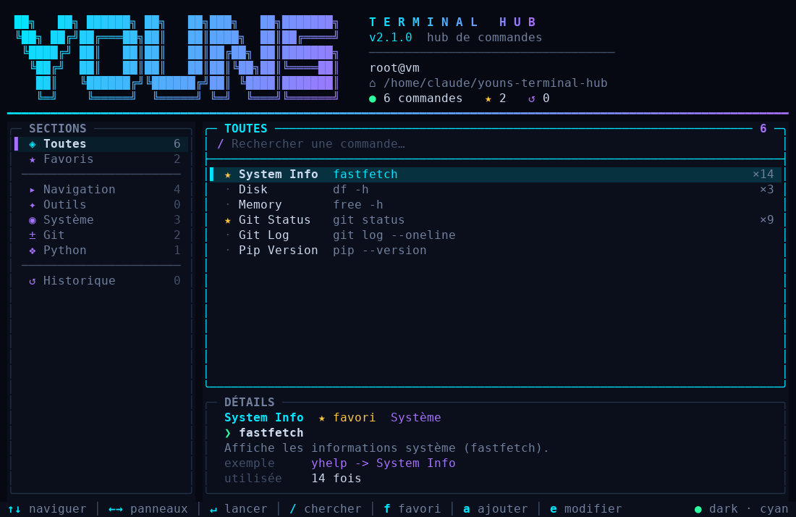
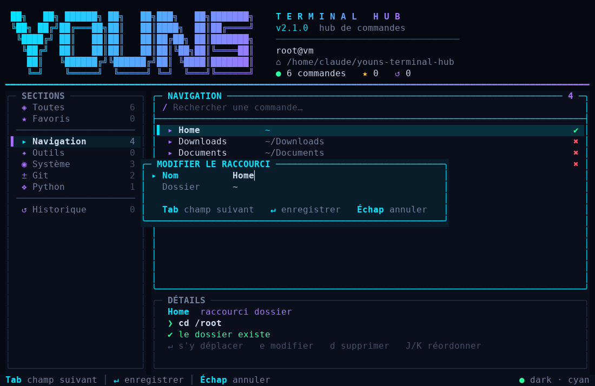

<div align="center">

# ▌YOUNS TERMINAL HUB

**Votre centre de commande dans le terminal : commandes, favoris, raccourcis de dossiers, historique.**
Sombre, néon, rapide, et **entièrement modifiable depuis l'interface**.




</div>

---

## Sommaire

- [Pourquoi ?](#pourquoi-)
- [Installation](#installation)
- [Premiers pas](#premiers-pas)
- [Gérer ses raccourcis et commandes](#gérer-ses-raccourcis-et-commandes)
- [Toutes les touches](#toutes-les-touches)
- [Ligne de commande](#ligne-de-commande)
- [Configuration](#configuration)
- [Comment fonctionne le changement de dossier ?](#comment-fonctionne-le-changement-de-dossier-)
- [Dépannage](#dépannage)
- [Développement](#développement)

## Pourquoi ?

Vous retapez toujours les mêmes commandes et vous faites `cd ../../..` dix fois par jour ?
Tapez `yhelp`, choisissez, validez. C'est tout.

- 📁 **Raccourcis de dossiers** : un `↵` et votre shell change *vraiment* de répertoire
- ✏️ **Tout se modifie dans l'interface** : ajouter, éditer, supprimer, réordonner (`a` `e` `d` `J` `K`), plus besoin d'ouvrir un JSON
- 🗂️ **Catégories** et **recherche instantanée** sur tout le catalogue
- ★ **Favoris**, compteur d'utilisation, **historique** relançable
- ▲ **Confirmation** avant toute commande marquée *dangereuse*
- 🧩 **Zéro dépendance** : Python standard uniquement
- 🎨 Thème sombre néon, truecolor avec repli 256 couleurs, `NO_COLOR` respecté, interface adaptative (60×16 minimum)

> ## ⚠️ Linux uniquement
> Conçu pour **Linux** (Bash ou Zsh) : il utilise `termios` et des pseudo-terminaux POSIX.
> Windows n'est pas supporté (WSL non testé) et macOS n'est pas testé. Les tests automatiques tournent sur Linux.

## Installation

```bash
git clone https://github.com/<votre-compte>/youns-terminal-hub.git
cd youns-terminal-hub
./install.sh
```

Ouvrez un **nouveau terminal**, puis :

```bash
yhelp
```

**Prérequis** : Linux, Python ≥ 3.9, Bash ou Zsh.

`install.sh` copie le programme dans `~/.local/share/youns-terminal-hub`, crée le lanceur
`~/.local/bin/yhelp-tui` et ajoute un bloc balisé (idempotent) à `~/.bashrc` / `~/.zshrc`
(et le `PATH` si nécessaire). Option `--no-rc` pour ne rien modifier.

**Mise à jour** : `git pull && ./install.sh`. Vos données (`~/.config/yhelp/`) ne sont jamais écrasées.
**Désinstallation** : `./uninstall.sh` (ajoutez `--purge` pour supprimer aussi vos données).

## Premiers pas

1. Lancez `yhelp`.
2. Sélectionnez la section **Navigation** (`←` puis `↓`) pour voir vos raccourcis de dossiers.
3. `↵` sur un dossier : vous y êtes. `↵` sur une commande : elle s'exécute, puis `↵` pour revenir au hub.
4. `?` ouvre l'aide à tout moment.

## Gérer ses raccourcis et commandes

Tout se fait au clavier, depuis l'interface. Les changements sont **enregistrés immédiatement**.



| Action | Touche | Détail |
|---|---|---|
| **Ajouter** | `a` | Dans *Navigation* : un raccourci de dossier. Ailleurs : une commande |
| Ajouter une commande depuis *Navigation* | `A` | |
| **Modifier** | `e` | Sur l'élément sélectionné (raccourci ou commande) |
| **Supprimer** | `d` ou `Suppr` | Demande confirmation (`y` / `n`) |
| **Réordonner** | `J` / `K` | Descend / monte un raccourci de dossier |
| Favori | `f` | Ajoute ou retire des favoris |

### Dans le formulaire

| Touche | Action |
|---|---|
| `Tab` / `↓`, `↑` | Champ suivant / précédent |
| *saisie*, `⌫`, `Ctrl+U` | Écrire, effacer un caractère, vider le champ |
| `←` `→` ou `Espace` | Changer la catégorie, cocher « dangereuse » |
| `↵` | **Enregistrer** |
| `Échap` | Annuler |

**Raccourci de dossier** : un *nom* (facultatif, déduit du dossier sinon) et un *dossier*
(`~` accepté). Le dossier courant est pré-rempli : lancez `yhelp` depuis le dossier voulu,
appuyez sur `a`, puis `↵`. Si le dossier n'existe pas, il est enregistré avec un avertissement (✖ dans la liste).

**Commande** : *nom*, *commande* (seul champ obligatoire), *description*, *catégorie*, *paramètres*,
*dangereuse*. Si *paramètres* est rempli, les arguments sont demandés avant l'exécution.

> 💡 Vous préférez éditer à la main ? Les fichiers JSON restent la source de vérité (voir
> [Configuration](#configuration)) ; `r` dans l'interface les recharge.

## Toutes les touches

| Touche | Action |
|---|---|
| `↑` `↓` / `j` `k` | Parcourir |
| `←` `→` / `Tab` | Changer de panneau (sections ↔ liste) |
| `↵` | Lancer la commande / aller dans le dossier |
| `/` | Rechercher (`Échap` pour effacer) |
| `f` | Ajouter / retirer des favoris |
| `a` · `A` | Ajouter (raccourci ou commande) · ajouter une commande |
| `e` | Modifier |
| `d` / `Suppr` | Supprimer |
| `J` / `K` | Descendre / monter un raccourci de dossier |
| `g` / `G`, `PgUp` / `PgDn` | Début / fin, page |
| `x` | Vider l'historique (vue Historique) |
| `r` | Recharger les fichiers JSON |
| `?` | Aide |
| `q` / `Échap` | Quitter |

## Ligne de commande

```text
yhelp-tui --list            affiche tout sans interface
yhelp-tui --where           affiche le dossier de configuration
yhelp-tui --config-dir DIR  utilise un autre dossier de configuration
yhelp-tui --reset           restaure les valeurs par défaut (anciens fichiers gardés en .bak)
yhelp-tui --version
```

> Pour que les raccourcis de dossiers changent réellement votre répertoire, lancez **`yhelp`**
> (la fonction shell) et non `yhelp-tui` directement.

## Configuration

Vos données vivent hors du dépôt, dans `~/.config/yhelp/` (ou `$YHELP_HOME`), copiées au premier lancement.
Favoris et historique ne sont donc jamais écrasés par une mise à jour.

| Fichier | Rôle |
|---|---|
| `shortcuts.json` | Raccourcis de dossiers (`~` accepté) |
| `commands.json` | Catalogue de commandes |
| `categories.json` | Catégories (`id`, `name`, `icon`) ; la catégorie `navigation` affiche vos raccourcis |
| `config.json` | Apparence |
| `history.json` | Historique (généré) |

Un fichier JSON invalide est sauvegardé en `.bak` et remplacé par les valeurs par défaut. Les écritures sont atomiques.

### Exemple : raccourci de dossier

```json
{ "id": "site", "name": "Mon site", "path": "~/Projets/site" }
```

### Exemple : commande

```json
{
  "id": "docker-ps",
  "name": "Docker PS",
  "command": "docker ps -a",
  "description": "Liste tous les conteneurs.",
  "category": "outils",
  "params": "",
  "example": "",
  "favorite": false,
  "use_count": 0,
  "dangerous": false
}
```

### Apparence (`config.json`)

| Clé | Valeurs |
|---|---|
| `theme` | `dark` (défaut), `midnight` (teinte violette) |
| `accent_color` | `cyan`, `violet`, `green`, `magenta`, `amber`, `blue`, `red` ou `#RRGGBB` |
| `show_logo` / `logo_mode` | `true`/`false` ; `ascii` ou `none` (le logo est la liste `ascii_logo`) |
| `icons` | `glyph` (défaut, alignement fiable) ou `emoji` (icônes de `categories.json`) |
| `background` | `solid` ou `transparent` |
| `confirm_dangerous` | `true` / `false` |
| `history_limit` | nombre d'entrées conservées (200) |

Variable d'environnement `YHELP_COLOR=truecolor|256|none` pour forcer le mode couleur
(dans tmux, activez le truecolor ou laissez le repli 256 couleurs).

## Comment fonctionne le changement de dossier ?

Un programme ne peut pas modifier le répertoire de son shell parent. `yhelp` est donc une **fonction shell**
(`yhelp.sh`) qui lance `yhelp-tui`, lit le chemin choisi dans un fichier temporaire (`YHELP_CD_FILE`),
puis exécute `cd` elle-même.

## Dépannage

| Problème | Solution |
|---|---|
| `yhelp: commande introuvable` | Ouvrez un nouveau terminal, ou `source ~/.local/share/youns-terminal-hub/yhelp.sh` |
| `yhelp-tui` introuvable | Ajoutez `~/.local/bin` au `PATH` (ou relancez `./install.sh` sans `--no-rc`) |
| `↵` sur un raccourci ne change pas de dossier | Utilisez `yhelp` (fonction shell), pas `yhelp-tui` |
| « Agrandissez le terminal » | Taille minimale : 60×16 |
| Couleurs ternes dans tmux | `export YHELP_COLOR=256`, ou activez le truecolor dans tmux |
| J'ai cassé mes fichiers | `yhelp-tui --reset` (les anciens fichiers sont gardés en `.bak`) |

## Développement

```bash
python3 -m unittest discover -s tests -v      # tests unitaires + test en vrai pseudo-terminal
PYTHONPATH=src python3 -m yhelp_tui --list    # lancer sans installer
python3 scripts/render_preview.py docs/screenshot.png 110x34   # régénérer l'aperçu (Pillow)
```

Les aperçus sont générés à partir du tampon de rendu réel de l'application (pas une maquette).

```
├── install.sh / uninstall.sh   installation Linux
├── yhelp.sh                    fonction shell (Bash/Zsh)
├── src/yhelp_tui/              application (ansi, keys, store, theme, app, cli)
│   └── defaults/               fichiers JSON par défaut
├── tests/                      tests automatiques (dont l'édition)
└── .github/workflows/ci.yml    intégration continue
```

## Licence

MIT, voir [LICENSE](LICENSE).
